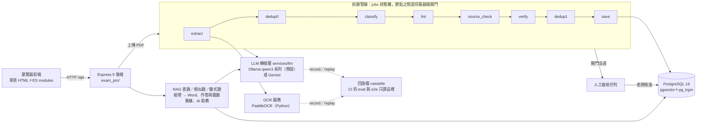
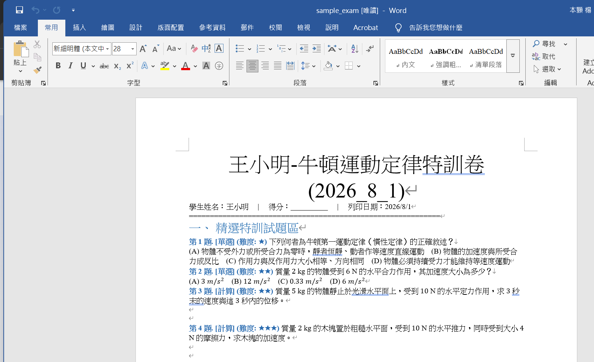

# tutor-exam-bank · 家教用高中數理題庫與出題系統

[](https://github.com/Tom-Yang-Ben/tutor-exam-bank/actions/workflows/ci.yml)

一位高中數理家教自己開發、自己使用的題庫與出題系統，涵蓋數學、物理、化學三科。上傳考卷 PDF 後，多 Agent 管線會依序拆題、分類、檢查公式、比對原卷、驗算答案，通過的題目存進題庫。題庫建好之後可以用 RAG 查題、找相似題，組卷後匯出 Word，還能記錄學生作答、安排錯題重練，也有 AI 助教。可執行的程式都在 [`exam_pro/`](./exam_pro)。

**現況（2026-10）**：預設是**本機模式**。AI 步驟全部在自己的電腦上跑（Ollama 的 qwen3 系列＋PaddleOCR），執行時不連外，也不花 API 費用。上傳考卷與助教也可以逐次改用 Gemini（需 API 金鑰），向量一律用本機模型。舊原型在 tag [`v1-mysql`](https://github.com/Tom-Yang-Ben/tutor-exam-bank/tree/v1-mysql)。


## 為什麼做這個

我當了五年高中數理講師。出一份針對學生弱點的考卷，過去要自己從舊考卷挑題、判斷章節、把公式重打成 Word，再記住每個學生錯在哪裡，大部分時間花在這些整理工作上，而不是教學本身。這套系統把這些步驟自動化：考卷 PDF 拆成可搜尋的題庫，依章節與弱點找題、組卷，直接輸出可編輯的 Word 考卷，並追蹤每位學生的錯題與重練。

## 架構



## 技術亮點

- **多 Agent 管線＋硬閘門**：流程由程式碼寫的狀態機控制，不交給 LLM 決定。管線有 8 個節點，每個 agent 都是純函式，輸出先過 JSON Schema（ajv）與章節白名單驗證才往下走。採**部分入庫**：通過的題直接入庫；沒通過的題會附上 12 種 `review_reason` 之一，停在人工複核。worker 認領工作用 `FOR UPDATE SKIP LOCKED` 加租約，中斷後可以接著跑。
- **hybrid 檢索**：向量（pgvector，768 維）和 jieba 分詞的全文檢索用 RRF 融合，寫成同一段 SQL（[`queries/hybrid.js`](./exam_pro/queries/hybrid.js)），API 和 eval 共用。golden 40 筆上的 Recall@5：hybrid **1.0000**，原本的 `LIKE` 查詢只有 **0.8750**。
- **LaTeX → Word OOXML 自己寫**：用手寫的 tokenizer 加遞迴下降解析器，直接產生 `docx` 的原生數學物件，匯出的是在 Word 裡可以點開編輯的直式分數和根式。範例 [`sample_exam.docx`](./exam_pro/sample_exam.docx) 是系統直接輸出、沒有手動修改的檔案，裡面有 33 個原生方程式。
- **回放式 eval 與 CI**：真實的模型回應只在作者的電腦上錄一次，存成 cassette。cassette 的鍵包含模型 ID 與輸入雜湊，CI 只讀 cassette，找不到就判失敗，不會改去呼叫模型。共有 5 個 eval suite，每個都對人工定案的 golden 量測；門檻寫在 [`thresholds.json`](./exam_pro/eval/thresholds.json)，只升不降。CI 有三個 job（unit 跑 Node 22／24、integration 用 pgvector service、desktop），整個流程不需要金鑰，也不連網。
- **本機模式**：在 16 GB RAM、只有 CPU 的筆電上，全部 AI 步驟都能跑：`qwen3-vl:8b`、`qwen3:8b`、`qwen3-embedding:0.6b`（輸出 768 維，所以資料表不用改）加上 PaddleOCR。代價是速度慢；另外預設只用 OCR 拆題，每一題都要由老師複核後才會入庫。
- **桌面版**：啟動器 A 是桌面圖示，點一下會依序開 Docker、資料庫、Ollama 和後端。Electron 桌面版 B1 把整套系統包進一個視窗，有背景工作時關掉視窗會縮到系統匣繼續跑，目前**待 Owner 驗收**。`desktop/` 的 126 項測試已納入 CI。

匯出的 Word 考卷（題目是自編的示範內容）：



## 評測（main 實測）

條件和 CI 相同：`LLM_MODE=replay`、`EMBED_MODE=fixture`，模型名稱照 [`ci.yml`](./.github/workflows/ci.yml) 的 env（本機模型 `ollama:qwen3*` 錄的回放檔），測試庫用 PostgreSQL 16＋pgvector。

| 項目 | 實測 | 門檻 | 結果 |
|---|---|---|---|
| unit／integration／e2e／desktop | 4,536（4,535 過、1 略過）／697／14 項中 12 過、2 略過／126 | 全過 | ✅ |
| retrieval | hybrid Recall@5 **1.0000**（LIKE 0.8750） | ≥ 0.97（共 9 個門檻） | ✅ |
| classify | accuracy **0.9891**、macro-F1 **0.9744** | ≥ 0.87、≥ 0.8956 | ✅ |
| nlq | 規則路徑：coverage 0.84、filters_exact 1.000、recall@10 1.000；LLM 輔路徑：filters_exact 1.000、recall@10 1.000 | 5 個門檻 | ✅ |
| pipeline | chapter_acc_rate（章節正確率）**1.00**、verify_agree_rate（驗算答案對標準答案）0.90；gate_pass_rate（分類零成本閘門）0.70 只報告 | ≥ 0.97、≥ 0.87 | ✅ |
| variant | retrieved_coverage **0.50**、gate_pass_rate 0.45（本機向量的門檻組） | ≥ 0.47、≥ 0.22 | ✅ |

- pipeline 在 OCR 模式下：saved_rate 設計上一律是 0（每題都停在複核）；分類零成本閘門通過率只報告（本機的分類呼叫不花錢，而拆題模型自己猜的章節不可靠），兩者都不跟門檻比，章節對不對由 chapter_acc_rate 把關。Gemini 模式照樣要求 gate_pass_rate ≥ 0.97。
- variant 的 retrieved_coverage 門檻依向量模型分開設：本機 `ollama:qwen3-embedding:0.6b`（相似度下限 0.72）是 0.47，`gemini-embedding-001` 是 0.8367。本機以相似題的精準度為優先，覆蓋率靠擴充題庫提高，不靠降低相似度下限。
- 重跑方法：`cd exam_pro && npm run eval -- --suite <retrieval|classify|pipeline|nlq|variant>`，詳見 [`exam_pro/eval/README.md`](./exam_pro/eval/README.md)。

## 技術棧

| 層 | 用什麼 |
|---|---|
| 後端 | Node.js 22／24、Express 5、PostgreSQL 16＋pgvector＋pg_trgm（Docker） |
| AI | Ollama（`qwen3-vl:8b`、`qwen3:8b`、`qwen3-embedding:0.6b`）＋PaddleOCR；可切回 Gemini（`@google/genai`） |
| 文件 | `docx`（自製 LaTeX → OOXML） |
| 前端 | 單頁 HTML＋ES modules（不用打包器）、Tailwind、MathJax，資源全部從本機載入 |
| 測試 | `node:test`、5 個 eval suite、cassette record／replay、GitHub Actions |
| 桌面 | Windows 啟動器（A）、Electron 44（B1） |

## 快速開始

```bash
cd exam_pro && npm install && cp .env.example .env
npm run db:up && npm run migrate     # Docker 起 PostgreSQL 16＋pgvector，套用 migrations
npm start                            # http://localhost:3000（預設只接受本機連線）
```

本機模型的安裝、`.env` 設定、桌面圖示、測試與維運指令，請看 **[`exam_pro/README.md`](./exam_pro/README.md)**。

## 文件索引

| 文件 | 內容 |
|---|---|
| [`exam_pro/README.md`](./exam_pro/README.md) | 安裝、設定、啟動、常用指令、常見問題 |
| [`docs/local-mode.md`](./docs/local-mode.md) | 本機模式：安裝、`.env`、切回 Gemini、速度與品質、重錄回放檔 |
| [`docs/desktop-launcher.md`](./docs/desktop-launcher.md) | 桌面啟動器 A（「出題系統」圖示） |
| [`docs/demo-script.md`](./docs/demo-script.md) | 現場操作腳本：順序、等待時間講什麼、退路 |
| [`docs/desktop-app-design.md`](./docs/desktop-app-design.md) | Electron 桌面版 B1 的設計與驗收步驟 |
| [`docs/llm.md`](./docs/llm.md) | LLM 轉接層、模型設定、cassette |
| [`docs/retrieval.md`](./docs/retrieval.md) | hybrid 檢索與自然語言查題 |
| [`docs/rag-and-agents.md`](./docs/rag-and-agents.md) | RAG 與多 Agent 的選型理由、限制與替代方案 |
| [`docs/chapter-restructure.md`](./docs/chapter-restructure.md) | 章節白名單對齊 108 課綱、舊題搬章 |
| [`docs/retrain-and-review.md`](./docs/retrain-and-review.md) | 錯題重練與間隔複習 |
| [`docs/HANDOFF.md`](./docs/HANDOFF.md) | 交接檔：目前狀態、Owner 決策紀錄與待辦 |
| [`engineering_docs/06_ops/deployment_and_operations.md`](./engineering_docs/06_ops/deployment_and_operations.md) | 部署、環境變數總表、升級與回滾 |
| [`engineering_docs/INDEX.md`](./engineering_docs/INDEX.md) | 需求、架構（SAD、ADR）、API、QA 等全部工程文件的索引 |

## 授權、著作權與安全

- **程式碼保留所有權利**：開放在 GitHub 上瀏覽和做技術評估，但不授權執行、複製、修改、散布，也不得放進資料集或拿來訓練模型（[`LICENSE`](./LICENSE)）。2026-08-24 之前的歷史版本曾以 Apache-2.0 釋出，那份授權只適用於那些歷史版本。
- **本 repo 不含任何題庫資料**：沒有考卷、試題，也沒有掃描檔。示範題（`seed_questions.js` 的 30 題）、eval 的 fixture 和 golden 都是作者自己編寫的。
- **匯入題目的著作權仍屬原著作權人**：這套系統只用來管理使用者自己合法擁有、或有權使用的題目（[`NOTICE`](./NOTICE)）。
- **安全**：後端預設只接受本機（`127.0.0.1`）的連線。`API_KEY` 會被注入前端頁面，**不能當作存取控制**。要對外部署時，必須設定 `ALLOWED_ORIGINS`、`NODE_ENV=production`，並在前面加反向代理做驗證；`.env` 不進版控。詳見 [`exam_pro/README.md`](./exam_pro/README.md#安全)。

## 作者

**楊本顥 Ben Yang**：前高中數學／物理講師（5 年），轉職 AI／資料工程。這個系統從需求、架構到實作與評測都由我一人完成，並在自己的教學中實際使用。聯絡：GitHub [@Tom-Yang-Ben](https://github.com/Tom-Yang-Ben)。

© 2026 Ben Yang (楊本顥)
