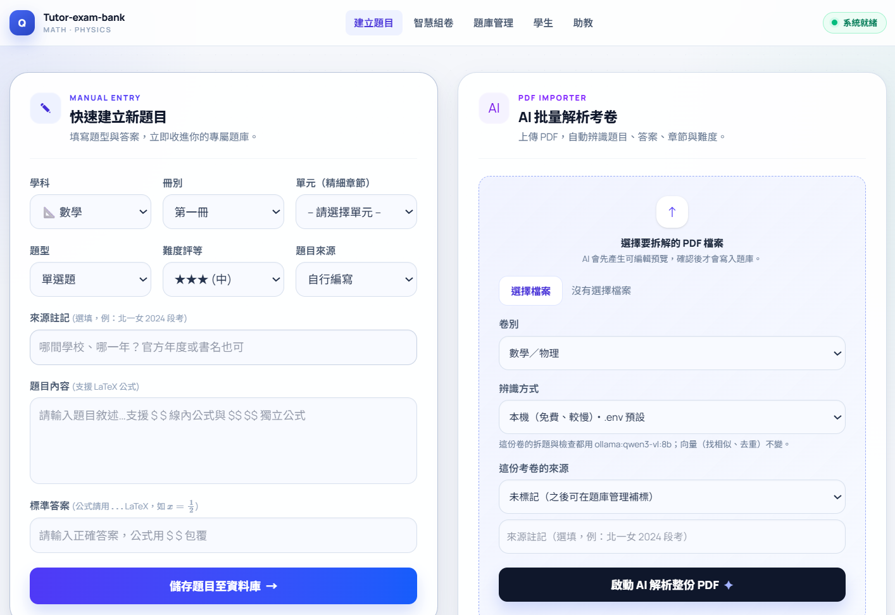
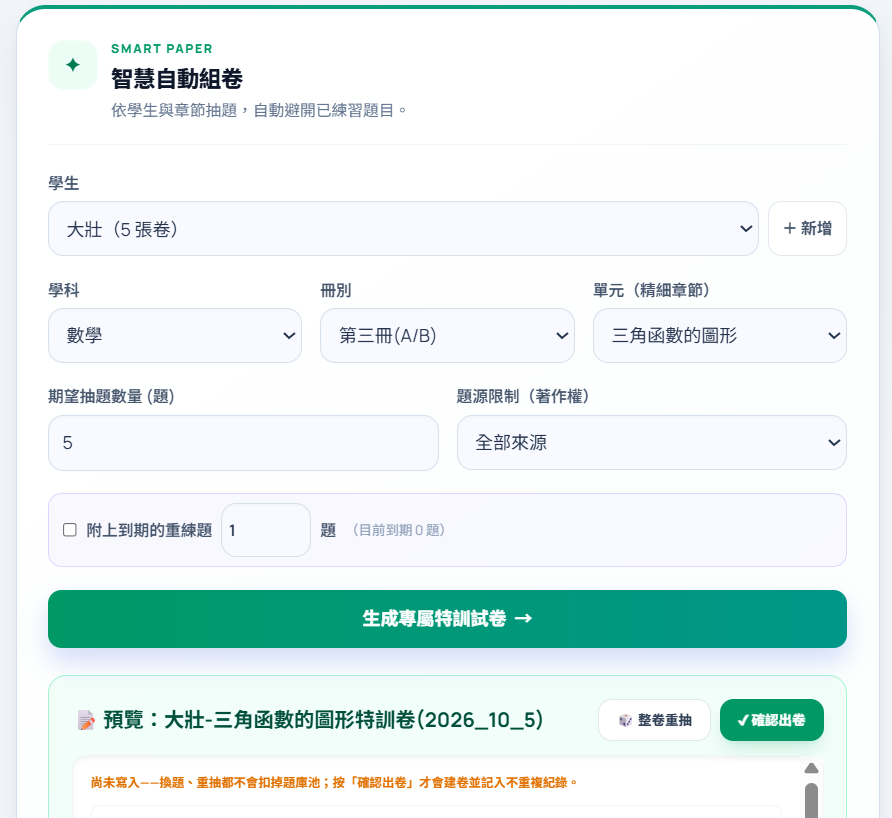
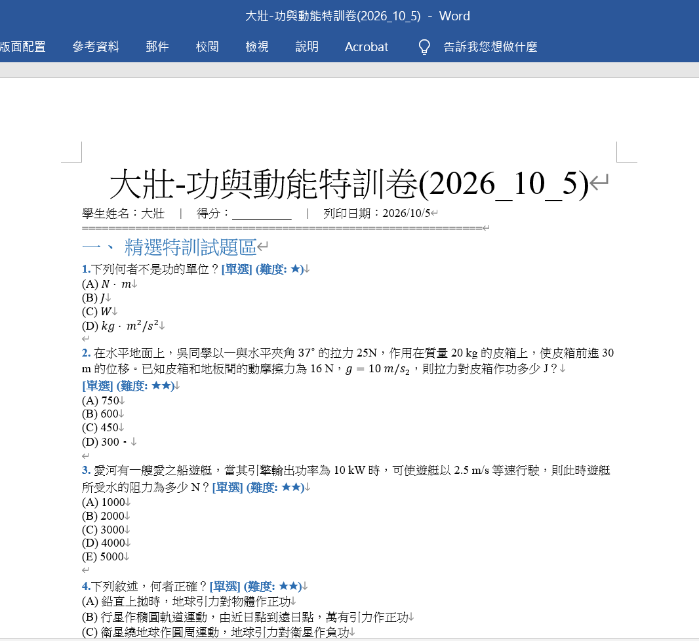
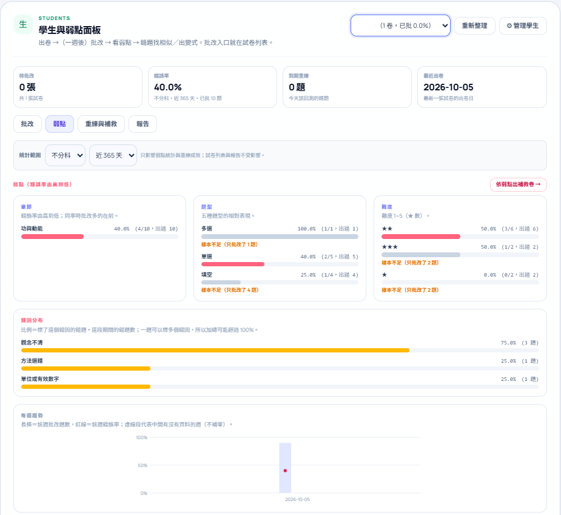
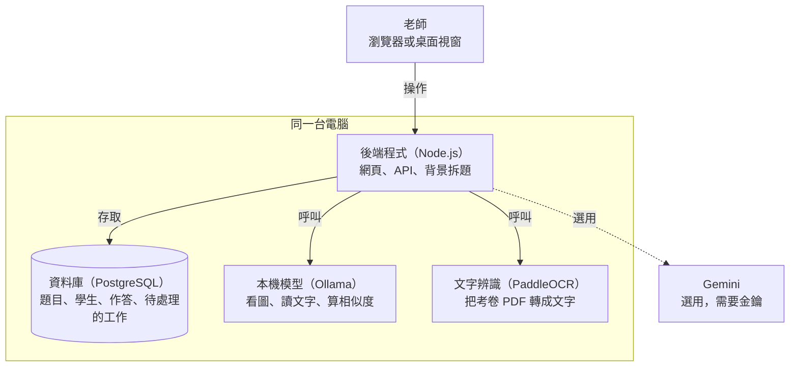
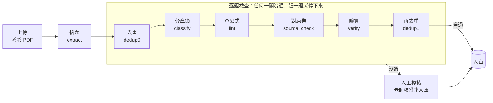

# tutor-exam-bank

[](https://github.com/Tom-Yang-Ben/tutor-exam-bank/actions/workflows/ci.yml)

高中數學、物理、化學的題庫與出題系統，供家教老師單機使用。考卷 PDF 經拆題管線轉成可檢索的題庫，再依章節與學生弱點組卷，匯出公式可編輯的 Word 考卷，並記錄每位學生的作答與錯題。

AI 步驟預設全部在本機執行（Ollama 與 PaddleOCR），不連外、不需要 API 金鑰；拆題與問答可逐次改用 Gemini。

<p align="center">
  <br><b>① 建立題目</b>：手動輸入，或上傳考卷 PDF 由系統拆題
</p>
<table>
  <tr>
    <td width="33%" align="center" valign="top"><br><b>② 智慧組卷</b><br><sub>依學生與章節抽題，確認前可換題</sub></td>
    <td width="33%" align="center" valign="top"><br><b>③ 匯出 Word 考卷</b><br><sub>公式是可編輯的原生方程式</sub></td>
    <td width="33%" align="center" valign="top"><br><b>④ 弱點分析</b><br><sub>批改後看章節、題型與錯因分布</sub></td>
  </tr>
</table>

<p align="center"><a href="#功能">功能</a> · <a href="#系統架構">系統架構</a> · <a href="#技術棧">技術棧</a> · <a href="#環境需求">環境需求</a> · <a href="#安裝與啟動">安裝與啟動</a> · <a href="#測試與評測">測試與評測</a> · <a href="#專案結構">專案結構</a> · <a href="#文件">文件</a> · <a href="#授權與著作權">授權</a></p>

## 功能

核心功能一律啟用。其餘功能各由一個 `FEATURE_*` 環境變數控制，**預設關閉**；關閉時對應的 API 不掛載、畫面不顯示。

| 功能 | 旗標 | 呼叫模型 |
|---|---|---|
| 題庫管理：新增、編輯、依科目與章節篩選 | 核心 | 否 |
| 組卷與 Word 匯出：LaTeX 轉成 Word 原生方程式 | 核心 | 否 |
| 學生名冊、出卷確認與刪卷 | 核心 | 否 |
| 考卷 PDF 拆題管線與人工複核 | `FEATURE_PIPELINE` | 是 |
| 相似題 | `FEATURE_SIMILAR` | 否（使用已存向量） |
| 自然語言查題 | `FEATURE_NLQ` | 規則解析為主，必要時呼叫 |
| 變式題生成 | `FEATURE_VARIANTS` | 是 |
| 批改、弱點分析、學習報告 | `FEATURE_STUDENTS` | 否 |
| 知識點與自動標註 | `FEATURE_KC`、`FEATURE_KC_TAGGING` | 僅自動標註 |
| 補救卷與題庫覆蓋率 | `FEATURE_REMEDIAL` | 否 |
| 錯題重練與間隔複習 | `FEATURE_RETRAIN` | 否 |
| 對話式助教（只讀工具） | `FEATURE_ASSISTANT` | 是 |
| AI 家教、按住說話 | `FEATURE_TUTOR`、`FEATURE_VOICE` | 是；語音僅支援 Gemini |

`FEATURE_PIPELINE` 關閉時，上傳區改走舊的同步拆題端點 `/api/analyze-pdf`，不經管線與複核佇列。

## 系統架構

整套系統跑在同一台電腦上：老師用瀏覽器或桌面視窗操作，後端程式負責網頁、API 與背景拆題，資料存在本機的資料庫。



上傳一份考卷之後，後端在背景依固定順序處理每一題。順序由程式寫定（[`pipeline/stateMachine.js`](./exam_pro/pipeline/stateMachine.js)），不交給模型決定。



- **背景工作**：上傳只建立一筆工作，由後端程式在背景認領（`FOR UPDATE SKIP LOCKED` 加租約）；程式中斷後，租約到期就能接著處理。
- **逐題檢查**：每一關的輸出先通過 JSON Schema 與章節白名單驗證。沒過的題目附上 12 種原因之一，停在人工複核；其餘題目照常入庫。
- **模型與文字辨識**：所有呼叫都經轉接層（[`services/llm`](./exam_pro/services/llm)、[`services/ocr`](./exam_pro/services/ocr)），有 live、record、replay 三種模式；replay 只讀回放檔，找不到即失敗，不會改呼叫模型。測試與評測因此不需要模型。
- **檢索**：向量檢索（768 維）與 jieba 分詞的全文檢索以 RRF 融合，寫在同一段 SQL（[`queries/hybrid.js`](./exam_pro/queries/hybrid.js)），供相似題、自然語言查題與變式題使用。題庫列表的關鍵字篩選是一般的 `ILIKE` 比對。
- **Word 匯出**：自製的 LaTeX 解析器直接產生 OOXML 數學物件（[`utils/textFormatter.js`](./exam_pro/utils/textFormatter.js)、[`services/wordService.js`](./exam_pro/services/wordService.js)），輸出範例見 [`sample_exam.docx`](./exam_pro/sample_exam.docx)。

## 技術棧

| 層 | 內容 |
|---|---|
| 後端 | Node.js 22／24、Express 5 |
| 資料庫 | PostgreSQL 16、pgvector、pg_trgm（Docker） |
| 模型 | Ollama：`qwen3-vl:8b`、`qwen3:8b`、`qwen3-embedding:0.6b`；PaddleOCR；可選 Gemini（`@google/genai`） |
| 前端 | 單頁 HTML 與 ES modules（不打包）、Tailwind、MathJax，資源由後端從本機供應 |
| 文件輸出 | `docx` |
| 測試 | `node:test`、supertest、回放式評測、GitHub Actions |
| 桌面 | Windows 啟動器（Node.js 腳本）；Electron 44 桌面版（[`desktop/`](./desktop)，驗收中） |

## 環境需求

- Node.js 24（CI 另以 22 驗證）
- Docker Desktop（Windows 使用 WSL2 後端）
- 本機模型：[Ollama](https://ollama.com/download)、Python 3.11 或 3.12，約 15 GB 磁碟空間；16 GB 記憶體、僅 CPU 即可執行，但單題處理以分鐘計
- 選用：Gemini API 金鑰

## 安裝與啟動

> 本節供作者本人與獲授權者使用。本 repo 的程式碼未授權第三方執行，見[授權與著作權](#授權與著作權)。

```bash
cd exam_pro
npm install
cp .env.example .env
npm run db:up        # 以 Docker 啟動 PostgreSQL（開發庫 5442、測試庫 5433）
npm run migrate      # 套用 migrations/
npm start            # http://localhost:3000
```

依範本的預設值啟動後，只有核心功能可用，模型呼叫也只讀回放檔。要使用完整功能，還需要三個步驟：

1. 安裝本機模型：Windows 執行 `exam_pro\scripts\windows\setup_local_ai.bat`。
2. 在 `.env` 把 `LLM_MODE` 與 `EMBED_MODE` 都設為 `live`。
3. 在 `.env` 開啟需要的 `FEATURE_*`，重新啟動。

設定項、常用指令、桌面啟動器與常見問題見 [`exam_pro/README.md`](./exam_pro/README.md)。

## 測試與評測

```bash
cd exam_pro
npm test                                  # 單元測試：不連資料庫、不連網
npm run eval -- --suite retrieval         # 評測：retrieval、classify、pipeline、nlq、variant
```

CI 有三個 job：unit（Node.js 22 與 24）、integration（pgvector 服務容器，含整合測試、e2e 與五個評測）、desktop。全程只讀回放檔與向量檔，不需要金鑰，也不連網。整合測試與 e2e 在本機的執行方式見 [`exam_pro/README.md`](./exam_pro/README.md#常用指令)。

評測以人工定案的 golden 為基準，門檻寫在 [`thresholds.json`](./exam_pro/eval/thresholds.json)，只升不降。下表為 main 依 CI 設定（`LLM_MODE=replay`、`EMBED_MODE=fixture`、本機模型的回放檔、OCR 拆題模式）的結果：

| 項目 | 結果 | 門檻 |
|---|---|---|
| 測試 | unit 4,536 項（1 項略過）、integration 697 項、e2e 14 項（2 項略過）、desktop 126 項 | 全數通過 |
| retrieval | hybrid Recall@5 1.0000（`LIKE` 查詢 0.8750） | ≥ 0.97 |
| classify | accuracy 0.9891、macro-F1 0.9744 | ≥ 0.87、≥ 0.8956 |
| nlq | filters_exact 1.000、recall@10 1.000（規則與 LLM 兩條路徑） | 共 5 項門檻 |
| pipeline | 章節正確率 1.00、驗算一致率 0.90 | ≥ 0.97、≥ 0.87 |
| variant | retrieved_coverage 0.50、gate_pass_rate 0.45 | ≥ 0.47、≥ 0.22 |

各指標的定義、依模型分設的門檻與重錄回放檔的方法見 [`exam_pro/eval/README.md`](./exam_pro/eval/README.md)。

## 專案結構

```text
tutor-exam-bank/
├── exam_pro/               系統本體
│   ├── server.js           進入點：啟動 API 與 job runner
│   ├── app.js              Express 應用：中介層、靜態資源、首頁注入
│   ├── routes/             路由（依 FEATURE_* 掛載）
│   ├── controllers/        HTTP 處理
│   ├── services/           領域服務；llm/、ocr/ 為模型與 OCR 轉接層
│   ├── pipeline/           拆題管線狀態機
│   ├── workers/            job runner
│   ├── agents/             管線各節點與 JSON Schema
│   ├── queries/            hybrid 檢索 SQL
│   ├── config/             功能旗標、模型、章節白名單
│   ├── migrations/         資料庫 migration（SQL）
│   ├── public/             前端
│   ├── ocr_service/        PaddleOCR 腳本（Python）
│   ├── scripts/            維運腳本、桌面啟動器、Windows 批次檔
│   ├── eval/               評測：golden、回放檔、門檻
│   └── test/               unit、integration、e2e
├── desktop/                Electron 桌面版
├── docs/                   功能、設計與維運文件
└── .github/workflows/      CI
```

## 文件

| 文件 | 內容 |
|---|---|
| [`exam_pro/README.md`](./exam_pro/README.md) | 設定、指令、Windows 維運、安全、常見問題 |
| [`docs/api/api_spec.md`](./docs/api/api_spec.md) | API 端點、認證、限流、錯誤語意；格式見同目錄的 OpenAPI 檔 |
| [`docs/ops/deployment_and_operations.md`](./docs/ops/deployment_and_operations.md) | 部署、環境變數總表、升級與回滾；同目錄有四份 runbook |
| [`docs/local-mode.md`](./docs/local-mode.md) | 本機模式：安裝、切換 Gemini、速度與品質、重錄回放檔 |
| [`docs/llm.md`](./docs/llm.md) | LLM 轉接層、模型設定、回放檔 |
| [`docs/retrieval.md`](./docs/retrieval.md) | hybrid 檢索與自然語言查題 |
| [`docs/rag-and-agents.md`](./docs/rag-and-agents.md) | 檢索與管線的選型理由、限制與替代方案 |
| [`docs/desktop-launcher.md`](./docs/desktop-launcher.md)、[`docs/desktop-app-design.md`](./docs/desktop-app-design.md) | 桌面啟動器、Electron 桌面版 |
| [`docs/HANDOFF.md`](./docs/HANDOFF.md) | 目前狀態、決策紀錄與待辦 |

其餘功能文件（化學、知識點、補救卷、錯題重練、AI 家教、附圖等）在 [`docs/`](./docs)。

## 授權與著作權

- **程式碼保留所有權利**（[`LICENSE`](./LICENSE)）：可在 GitHub 上瀏覽與做技術評估；未經授權不得執行、複製、修改、散布，也不得納入資料集或用於訓練模型。2026-08-24 之前的歷史版本曾以 Apache-2.0 釋出，該授權僅適用於那些版本。
- **本 repo 不含題庫資料**：沒有題庫匯出檔、考卷 PDF 或掃描檔。示範題、評測用的 fixture 與 golden 均為作者自行編寫；`screenshots/` 的畫面截圖裡出現的題目取自學校段考試題。
- **匯入題目的著作權屬原著作權人**：本系統僅用於管理使用者合法持有或有權使用的題目（[`NOTICE`](./NOTICE)）。
- **安全**：後端預設只接受本機連線；`API_KEY` 會注入前端頁面，不能作為存取控制。對外部署的要求見 [`exam_pro/README.md`](./exam_pro/README.md#安全)。

作者：楊本顥 Ben Yang（[@Tom-Yang-Ben](https://github.com/Tom-Yang-Ben)）。© 2026 Ben Yang
